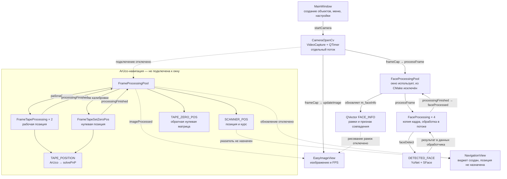
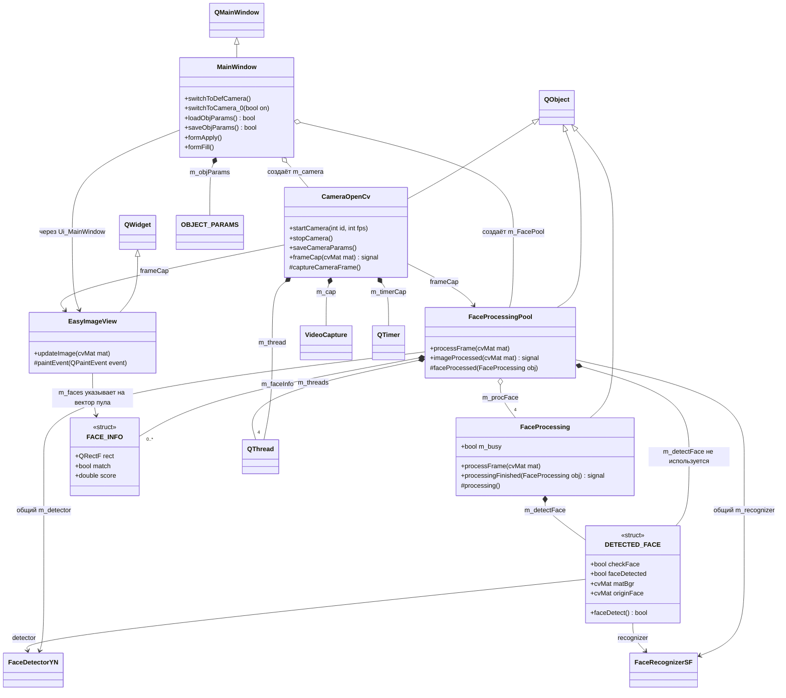
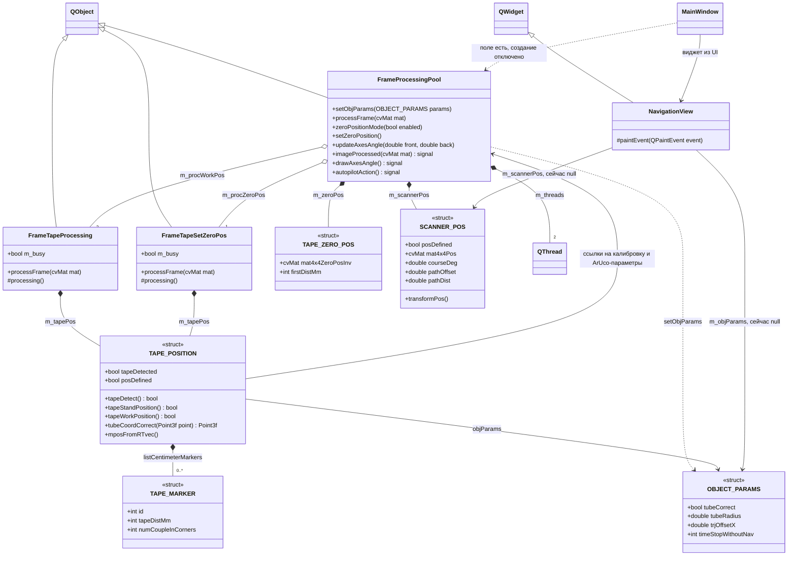
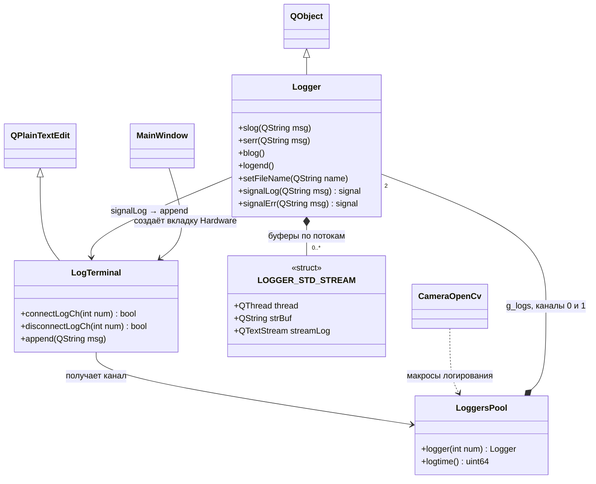

# Функциональная схема классов WeildScanner

Анализ исходников на 08.10.2026, базовый коммит `6aefefa`, с учётом обнаруженных при заключительной проверке локальных изменений `CMakeLists.txt` и `apcamera/easyimageview.cpp`. Выполнен статический анализ C++/Qt-кода, UI и CMake. Приложение не запускалось, сборка и работа с камерой не проверялись. В рамках анализа создан только этот документ.

## 1. Что представляет собой текущий проект

Приложение на C++17, Qt Widgets и OpenCV. Точка входа `main.cpp` создаёт `QApplication` и `MainWindow`.

В конструкторе `MainWindow` подключены камера, просмотр изображения и пул распознавания лиц. Однако в текущих локальных изменениях файлы `FaceProcessing` и `FaceProcessingPool` уже исключены из CMake, а рисование рамок лиц в `EasyImageView` закомментировано. Получилось промежуточное состояние: окно ещё использует подсистему лиц, которую конфигурация сборки уже не включает. При восстановлении её сборки отсутствие ONNX-моделей заставит пул пропускать обработку. В проекте также есть модуль позиционирования по ArUco-ленте, но создание его пула и подключения к видеопотоку закомментированы. `NavigationView` создаётся формой, однако указатель на позицию сканера ему не назначается.

Лазерная линия, триангуляция, V-образная разделка и слежение за сварным швом в исходниках пока не реализованы. Наличие трёхмерных матриц в навигационном модуле относится к позе маркерной ленты, а не к восстановлению лазерного профиля.

Ниже «подключено» означает наличие создания объектов и связей в исходниках. Это не подтверждение успешного запуска: обнаружено обращение к неинициализированному `m_procPool` при подключении меню калибровки.

## 2. Функциональный поток

Сплошные стрелки показывают подключённый поток данных. Пунктир на этой схеме обозначает отключённые подключения. Блок ArUco показывает внутреннюю реализацию, которая сейчас не создаётся окном.

`FaceProcessingPool::imageProcessed` испускается, но в `MainWindow` ни к чему не подключён. Просмотрщик получает исходный видеопоток; указатель `m_faces` по-прежнему назначается окном, но чтение и отрисовка рамок локально отключены. В исходной реализации они брались из последнего завершённого результата. Кадр изображения и результат детекции не связаны общим идентификатором.

## 3. Классы камеры, интерфейса и распознавания лиц

В диаграммах классов: `<|--` — наследование, `*--` — данные по значению или явно управляемый ресурс, `o--` — хранимые указатели на создаваемые объекты, `-->` — ссылка или взаимодействие, `..>` — зависимость. Пунктир здесь имеет смысл UML-зависимости, а не отключённого сигнала.

Сигнатуры в диаграммах сокращены: `cvMat` означает `cv::Mat`; указатели, перегрузки и служебные методы Qt показаны не полностью. В `MainWindow` также есть переключатели камер 1–3.

| Класс / структура | Функция и фактическое поведение | Исходники |
|---|---|---|
| `MainWindow` | Собирает приложение, связывает сигналы, переключает камеры, сохраняет геометрию окна через `QSettings`. Содержит методы XML-настроек навигации, но их вызов из рабочего интерфейса не подключён. | `mainwindow.h/.cpp`, `mainwindow.ui` |
| `CameraOpenCv` | Открывает камеру по числовому ID; `QTimer` вызывает `grab/retrieve`, затем испускается `frameCap`. В окне запрашивается период 25 кадров/с; задаётся разрешение 320×240. Значение FPS управляет таймером, фактическая частота камеры не измерена. | `apcamera/cameraopencv.h/.cpp` |
| `FaceProcessingPool` | Запускает четыре потока, загружает YuNet/SFace, передаёт кадр первому свободному обработчику. Если все заняты, кадр пропускается. Собирает `FACE_INFO`. | `apcamera/faceprocessingpool.h/.cpp` |
| `FaceProcessing` | Клонирует кадр, выставляет `m_busy`, через `QTimer::singleShot` запускает `processing()` в своём потоке; возвращает сигнал с указателем на себя. | `apcamera/faceprocessing.h/.cpp` |
| `DETECTED_FACE` | Хранит кадр, ссылки на модели и результаты. Выполняет детекцию, выравнивание лица, извлечение признаков и опциональное сравнение с эталоном. В пуле `checkFace = false`. Несмотря на комментарий в заголовке, `currentFaces` содержит строки детекции с геометрией, а не embeddings. | `appstructs.h/.cpp` |
| `FACE_INFO` | Прямоугольник, признак совпадения и `score`. Поле `score` при формировании результата сейчас не заполняется. | `appstructs.h`, `apcamera/faceprocessingpool.cpp` |
| `EasyImageView` | Преобразует BGR в RGB, рисует изображение, FPS поступления кадров и разрешение. Рисование рамок лиц в текущих локальных изменениях отключено. Отдельного пути отображения монохромного кадра нет. | `apcamera/easyimageview.h/.cpp` |

## 4. Классы навигации по маркерной ленте

Эта подсистема присутствует в исходниках и включена в Qt6-ветку сборки, но её пул сейчас не создаётся в `MainWindow`. Это позиционирование по известной геометрии маркеров через `solvePnP`.

| Класс / структура | Функция | Исходники |
|---|---|---|
| `FrameProcessingPool` | Загружает калибровку камеры и нулевую позу. Переключает обработку между установкой нуля и рабочей навигацией. Собирает позу, курс и поперечное отклонение. | `apcamera/frameprocessingpool.h/.cpp` |
| `FrameTapeProcessing` | Копирует кадр; вызывает `tapeDetect()` и при успехе `tapeWorkPosition()`. | `apcamera/frametapeprocessing.h/.cpp` |
| `FrameTapeSetZeroPos` | Копирует кадр; вызывает `tapeDetect()` и `tapeStandPosition()`. Использует первый поток пула, общий с первым рабочим обработчиком. | `apcamera/frametapesetzeropos.h/.cpp` |
| `TAPE_POSITION` | Объединяет состояние кадра и алгоритмы: ArUco, поиск пар метровых/сантиметровых маркеров, их сортировку, физическую модель ленты, `solvePnP`, построение матрицы 4×4 и поправку на кривизну трубы. | `appstructs.h/.cpp` |
| `TAPE_MARKER` | Описывает маркер, его пару и отметку расстояния. Фактическая формула: `id_cm * 10 + (id_m - 100) * 1000`, в миллиметрах. | `appstructs.h/.cpp` |
| `TAPE_ZERO_POS` | Хранит обратную матрицу нулевой позы и первую видимую отметку ленты. | `appstructs.h/.cpp` |
| `SCANNER_POS` | Хранит текущую позу, курс, углы осей и дистанцию; преобразует точки. Перегрузка с `QVector3D` дополнительно меняет знак X и добавляет `STAND_OFFSET_Y`. | `appstructs.h/.cpp` |
| `OBJECT_PARAMS` | Параметры трубы, смещения траектории, границ дистанции и тайм-аута потери навигации. Само наличие полей не означает реализацию управления движением. | `appstructs.h/.cpp` |
| `NavigationView` | Рисует оси сканера, курс, матрицу и координаты. В `paintEvent()` также изменяет `SCANNER_POS::pathDist`, то есть расчёт состояния зависит от перерисовки интерфейса. | `apcamera/navigationview.h/.cpp` |

Алгоритм рабочей навигации:

1. Обнаружить ArUco-маркеры и сформировать пары с известными отметками расстояния.
2. Построить соответствия координат углов в изображении и на физической ленте; при необходимости скорректировать модель ленты по радиусу трубы.
3. Выполнить `solvePnP` с матрицей камеры и коэффициентами дисторсии.
4. Построить матрицу позы и вычислить `m_zeroPos.mat4x4ZeroPosInv * m_tapePos.mat4x4Pos`.
5. Записать `SCANNER_POS`, вычислить курс и отклонение, испустить `autopilotAction()`.

У `autopilotAction()` нет подключённого исполнителя управления роботом в текущем проекте. Загружаемые коэффициенты дисторсии используются в оценке позы; отдельной коррекции изображения или лазерных точек здесь нет.

## 5. Логирование

`LOGGER_ALLOC(1)` создаёт глобальный `g_logs` с двумя каналами: конструктор добавляет канал 0. В окне терминал подключён к каналу 0. `m_apTerm` объявлен, но не создаётся. Файловая запись поддержана классом `Logger`, однако вызовов настройки `setFileName()` из приложения нет. Регистратора кадров, профилей и измерений шва нет.

Исходники: `logger/logger.h/.cpp`, настройка каналов — `mainwindow.cpp`.

## 6. Потоки, данные и жизненный цикл

| Контекст | Объекты и выполнение |
|---|---|
| GUI-поток | `MainWindow`, виджеты, `FaceProcessingPool`; здесь принимаются кадры, выбирается свободный worker и собираются результаты. При подключении ArUco здесь также работал бы `FrameProcessingPool`. |
| Поток камеры | `CameraOpenCv`, его `QTimer`, операции `VideoCapture`. Методы `startCamera/stopCamera` вызываются окном и планируют выполнение слотов в потоке камеры. |
| Четыре потока лиц | По одному `FaceProcessing` на поток. `processFrame()` вызывается напрямую из пула в GUI-потоке и клонирует изображение; `processing()` запускается в потоке worker. |
| Два потока ArUco | По одному `FrameTapeProcessing` на поток; `FrameTapeSetZeroPos` назначен первому потоку. Эта подсистема сейчас не создаётся. |

Передаётся `cv::Mat` без номера кадра и времени захвата. Обработчик клонирует изображение уже после доставки в GUI-поток; сама передача `frameCap(m_matFrame)` не создаёт глубокую копию. Следует проверить владение буфером при его повторном использовании камерой. Результаты параллельных обработчиков принимаются в порядке завершения; отбрасывания устаревших результатов нет. Пропуск кадра при занятости всех worker не ограничивает саму очередь сигналов камеры в GUI.

## 7. Обнаруженные проблемы, влияющие на архитектуру

| Приоритет | Наблюдение по исходникам | Последствие / требуемое изменение |
|---|---|---|
| Высокий | В текущем `CMakeLists.txt` исключены реализации `FaceProcessingPool` и `FaceProcessing`, но `MainWindow` продолжает создавать и использовать пул. | Конфигурация исходников не соответствует зависимостям окна; ожидаются ошибки линковки при новой сборке. Завершить отключение подсистемы лиц либо вернуть её файлы в цель сборки. |
| Высокий | `mainwindow.cpp:19` — создание `m_procPool` закомментировано; строки 57–58 используют этот указатель в `connect`. В заголовке он не инициализирован. | Неопределённое поведение уже при конструировании окна. Инициализировать поле и подключать меню только к существующему объекту. |
| Высокий | `faceprocessingpool.cpp:58–59` передаёт всем worker одни и те же `FaceDetectorYN` и `FaceRecognizerSF`; в `faceDetect()` вызываются изменяющие состояние операции без блокировки. | Параллельный доступ к общим моделям требует проверки потокобезопасности. Предпочтительно создавать отдельный экземпляр моделей на worker либо сериализовать работу с ними. |
| Высокий | `CameraOpenCv` и `FaceProcessingPool` создаются без родителей, а деструктор `MainWindow` удаляет только `ui`. Worker в деструкторах пулов также явно не удаляются. | Нет управляемого завершения всей цепочки: камера и пулы не освобождаются окном. Нужен явный порядок остановки захвата, завершения задач, потоков и удаления объектов. |
| Средний | `frameprocessingpool.h:10` и `faceprocessingpool.h:7` определяют один глобальный макрос `THREADS` со значениями 2 и 4. | Переопределение макроса и зависимость размеров массивов от порядка включения. Заменить на отдельные константы классов. На диаграммах отражён порядок включения в текущих исходниках. |
| Средний | `cameraopencv.cpp:15` может вызвать сохранение настроек до присвоения `m_cameraId`; при неудачной загрузке значения по умолчанию тоже нет. | Неопределённый ID камеры. Задать валидное начальное значение до чтения/создания XML. |
| Средний | Общий изменяемый вектор рамок, отсутствие `frameId/timestamp`, независимый видеопоток в просмотрщик. | Рамки могут относиться к другому кадру; старый результат может заменить новый. Нужен пакет кадра и результата с общей меткой времени/номером. |
| Средний | В `FrameProcessingPool` пути к калибровке и нулевой позиции жёстко заданы на `J:/WorkProjects/AutoWeldScanner/autopilot/`. | Конфигурация привязана к чужому каталогу; нет полноценной проверки калибровки перед обработкой. |
| Средний | `NavigationView::paintEvent()` вычисляет и записывает дистанцию. | Результат модели зависит от перерисовки GUI. Перенести вычисление в обработчик, передавать виджету готовый результат. |

Дополнительно: Qt5-ветка `CMakeLists.txt` не включает реализации из `apcamera` и `logger`, хотя окно их использует; `logger.cpp` содержит Qt6 API `QStringConverter`. Поэтому заявленную CMake совместимость с Qt5 нельзя считать реализованной. В `NavigationView` метод `setScanerPos()` объявлен, но реализации и вызовов в исходниках нет.

## 8. Соответствие ранее присланному ТЗ

Оценка относится к имеющемуся коду; требований после оборванного фрагмента «Все ге» в сообщении нет.

| Требование | Состояние |
|---|---|
| 1. Захват камеры | Реализован базовый `VideoCapture`; из GUI запрашивается 25 FPS, достижение 60–100 FPS не проверено. |
| 2. Субпиксельное выделение лазерной линии | Отсутствует. |
| 3. Подавление дуги, отражений, дыма, брызг | Отсутствует специализированная обработка. |
| 4. Коррекция дисторсии | Частично: коэффициенты передаются в `solvePnP` ArUco-подсистемы; коррекции лазерного изображения/точек нет. |
| 5. Триангуляция профиля | Отсутствует; лазерная плоскость не описана. |
| 6. Обнаружение V-разделки | Отсутствует. |
| 7. Центр, ширина, глубина, угол | Отсутствуют модель измерения и расчёт. |
| 8. Межкадровое слежение за швом | Отсутствует; обработчики независимо анализируют кадры. |
| 9. Прогноз при потере измерений | Отсутствует. |
| 10. Координаты робота | Есть матрицы навигации по ленте; калибровка и преобразование координат лазерного датчика в систему робота отсутствуют. |
| 11. Последовательность точек шва | Отсутствует. |
| 12. Передача координат роботу | Отсутствует транспорт/протокол. Сигнал `autopilotAction()` сам по себе передачу не выполняет. |
| 13. Визуализация | Есть видеопросмотр и отключённый от данных виджет навигации; рисование рамок лиц локально отключено, визуализации лазерного профиля нет. |
| 14. Запись измерений и диагностики | Есть текстовые логи и терминал; специализированной записи измерений/кадров нет. |
| 15. Настройка расстояния и алгоритма | Есть параметры камеры и маркерной навигации; рабочих параметров лазерного датчика нет. |
| Камера / видео / синтетика | Реализована камера по ID; общего интерфейса источника, источника видеофайлов и генератора синтетики нет. |

## 9. Направление дальнейшей разработки

Это предложение, а не описание существующих классов. Для выполнения ТЗ целесообразно сохранить оболочку Qt, переработать захват и просмотр, а обработку шва вынести в самостоятельный конвейер:

`IFrameSource → FramePacket → LaserLineExtractor → CameraModel → LaserTriangulator → VGrooveDetector → SeamTracker → RobotTransform → SeamPath / RobotOutput / MeasurementRecorder`.

Реализации `IFrameSource`: камера, видеофайл и синтетика. `FramePacket` должен фиксировать номер, время захвата и владение пиксельным буфером. Калибровка должна включать параметры камеры, уравнение лазерной плоскости и преобразование в систему робота. Результат измерения должен содержать единицы, систему координат, качество и признак «измерено/прогноз». Отдельный виджет отображает готовый результат без изменения состояния алгоритма. Порядок обновления трекера и предельный возраст отправляемых роботу данных нужно задавать явно.

ArUco-навигацию можно сохранить отдельным модулем для стенда, если она нужна процессу калибровки. Распознавание лиц функционально не относится к присланному ТЗ лазерного датчика.
