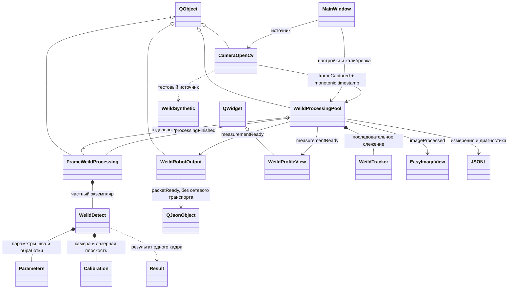

# Модуль лазерного датчика WeildScanner

Реализация использует существующие C++17, Qt Widgets, OpenCV и каталог `apcamera`. Основной тракт приложения переключён с незавершённого распознавания лиц на обработку лазерного шва. Старые классы ArUco-навигации сохранены отдельно.

## Классы и поток данных



`WeildDetect` инкапсулирует параметры и методы обработки изображения. Он не содержит межкадрового состояния и не обращается к GUI. Каждый `FrameWeildProcessing` имеет собственный экземпляр детектора. По аналогии с `FrameProcessingPool`, `WeildProcessingPool` распределяет кадры между свободными обработчиками и принимает сигналы завершения. Флаг занятости находится в самом пуле; worker вызывается очередью Qt в его собственном потоке.

Состояние трекера принадлежит пулу: это исключает независимое сопровождение одного шва несколькими потоками. Устаревшие результаты отбрасываются по номеру, времени и поколению конфигурации. Смена источника/калибровки/параметров сбрасывает трекер и траекторию; результаты уже выполняющихся старых заданий игнорируются.

## Алгоритм `WeildDetect`

1. Принимает Mono8, BGR8 или BGRA8; переводит цвет в монохромное изображение. Другие форматы диагностируются, а не пересчитываются с неизвестным масштабом яркости.
2. В заданном ROI сглаживает шум и выполняет вертикальный top-hat для удаления широкого светового фона.
3. Ищет максимум сигнала в каждом столбце; отбрасывает слишком широкую или сильно насыщенную полосу. Уточняет центр взвешенным центроидом с дробной координатой. Медианная проверка соседей подавляет отдельные выбросы.
4. Корректирует координаты найденных точек через `cv::undistortPoints`, получая нормированные лучи камеры.
5. Для луча `r = (x, y, 1)` и плоскости `n·X + d = 0` вычисляет `X = -d·r / (n·r)`. Отбрасывает лучи, почти параллельные плоскости, точки за камерой и вне диапазона рабочего Z.
6. Проецирует облако в ортонормированный двумерный базис лазерной плоскости. По краям видимого профиля оценивает опорную поверхность; две грани V-разделки аппроксимирует прямыми с Huber-оценкой через `cv::fitLine`.
7. Проверяет полную модель «поверхность — левая грань — правая грань — поверхность»: размеры, угол, ошибки, долю согласованных точек, разрывы и качество.

**Определения измерений:**

- Центр шва — корень V, пересечение аппроксимированных граней (`centerCamera`).
- Ширина — расстояние между пересечениями граней и опорной поверхности.
- Глубина — перпендикулярное расстояние от корня до опорной поверхности.
- Угол — внутренний угол между гранями, в градусах.
- `trackedCamera` — отфильтрованный центр либо прогноз. Исходное измерение хранится отдельно.
- Качество — эвристическая оценка покрытия и остаточной ошибки, не метрологическая погрешность.

Расстояния измеряются в миллиметрах. Оси камеры: X вправо, Y вниз, Z вперёд. Виджет профиля показывает X/Z камеры с одинаковым масштабом осей; ширина и глубина рассчитываются в плоскости лазера, а не по проекции X/Z.

Алгоритм предполагает одну лазерную полосу, пересекающую ROI по столбцам, видимую поверхность по обе стороны разделки и углубление с увеличением Z камеры. Сложная форма, скруглённое дно, несколько отражённых линий, полностью закрытые дымом участки, отсутствие обеих кромок требуют отдельной проверки/развития алгоритма. Обработка помех здесь является начальным вариантом; устойчивость непосредственно возле сварочной дуги не подтверждена без записей реального датчика.

## Захват, очередь и слежение

`CameraOpenCv` работает в отдельном потоке; поддерживает камеру по ID, видеофайл и физически спроецированную синтетику. Таймер использует `Qt::PreciseTimer`. Для камеры запрашиваются 80 FPS и разрешение калибровки (по умолчанию 640×480). Поддержка этих режимов определяется камерой и backend OpenCV; получение Global Shutter, экспозиции и аппаратного timestamp через SDK конкретной камеры в этом модуле не реализовано.

`frameCaptured` подключён к `submitFrame` через `Qt::DirectConnection`. Этот вход потокобезопасен: копирует буфер до возврата в захват и сохраняет только последний ожидающий кадр. В работе максимум два кадра и один ожидающий. GUI не получает отдельную очередь исходных кадров.

Время — локальное монотонное `steady_clock`, наносекунды, фиксируется после получения изображения. Для видео воспроизведение идёт с частотой файла; это время выдачи, а не исходный timestamp съёмки. Для аппаратной синхронизации с роботом нужна привязка к часам камеры/робота.

Трекер использует alpha-beta фильтр с постоянной скоростью, отсечение скачков и ограниченный прогноз (по умолчанию 0,15 с от последнего измерения). Предел возраста результата — 0,10 с. При поступлении кадров без измерения выдаётся прогноз, затем состояние `Lost`. Watchdog обрабатывает полное прекращение кадров. Прогноз не продлевает срок допустимой потери.

`path()` хранит только реально измеренные точки и их фильтрованные координаты. По умолчанию сохраняются последние 10000 точек, без изображений и облаков. Если датчик перемещается вместе с роботом, перевод всей траектории в неподвижную базу требует синхронизированных поз робота на момент каждого кадра; текущая калибровка содержит фиксированное преобразование.

## Калибровка

Меню **Калибровка → Загрузить калибровку…** читает YAML/XML формата OpenCV:

| Поле | Формат |
|---|---|
| `camera_matrix` | Матрица 3×3: fx, fy, cx, cy, последняя строка 0 0 1; skew=0. |
| `distortion_coefficients` | Вектор из 4, 5, 8, 12 или 14 коэффициентов стандартной pinhole-модели OpenCV; допустим пустой. |
| `image_width`, `image_height` | Разрешение, для которого выполнена калибровка. Несовпадение с кадром блокирует метрические измерения. |
| `laser_plane` | Матрица-вектор из четырёх коэффициентов `[nx, ny, nz, d]` в системе камеры; расстояния в мм. |
| `camera_to_robot` | Необязательная однородная матрица 4×4: `X_robot = T * X_camera`. Проверяются последняя строка и ортонормальность вращения. |

Если матрица робота отсутствует, `robotValid=false`, а координаты робота не публикуются. Единичная матрица не подставляется как действительная калибровка. Без калибровки камеры/лазера доступны только пиксельная линия и диагностическое изображение.

Файл `examples/synthetic-calibration.yml` предназначен **только для тестового источника**. Для реального датчика нужно измерить внутренние параметры камеры, плоскость лазера и привязку к роботу. Это загрузчик результатов калибровки, а не мастер её получения.

В синтетическом режиме используются отдельные параметры камеры и лазера, не заменяющие загруженную реальную калибровку. При возврате к камере/видео восстанавливается реальная калибровка.

## Интерфейс и настройки

- **Источник:** камеры 0–3, видеофайл, синтетический V-шов, остановка. При обычном старте источник выбирается пользователем.
- **Параметры шва:** рабочее Z и допуск, порог сигнала, качество, допустимые размеры, ошибка аппроксимации и длительность прогноза. Изменения вступают в силу по кнопке «Применить параметры».
- Полный набор параметров, включая ROI, углы, ограничения полосы и очереди, можно сохранить/загрузить YAML/XML. Пример — `examples/weild-parameters.yml`.
- **Запись:** журнал JSONL, по одному результату в строке. Новый запуск записи дописывает файл; ошибка записи выводится в диагностику и останавливает запись.
- Слева — исходный кадр с выделенной полосой и тремя геометрическими точками; справа — профиль и численные результаты. Прогноз визуально помечен. Размеры при прогнозе относятся к последнему измеренному профилю.

## Заглушка робота

По запросу пользователя протокол не выбран: `WeildRobotOutput` не содержит сокетов и ничего не отправляет оборудованию. Он формирует `QJsonObject`, хранит последний пакет и испускает `packetReady`. Будущий адаптер протокола подключается к этому сигналу.

Пакет содержит версию схемы, номер кадра, поколение конфигурации, монотонный timestamp, систему координат, единицы, качество и состояния `measured/predicted/lost`. Координаты добавляются только при наличии действительного преобразования и измерения/прогноза. Числа `frame_id`, `generation`, `timestamp_ns` представлены строками, чтобы не терять 64-битную точность в JSON.

Журнал дополнительно содержит исходный измеренный корень в системе камеры, фильтрованную позицию, размеры, время обработки, число пропущенных кадров и диагностическую причину отказа. Запись изображений/видеофайла не выполняется.

## Сборка и проверка

На текущем Windows-окружении:

```powershell
cmake -S . -B build/weild-module -G Ninja -DCMAKE_BUILD_TYPE=Release -DCMAKE_CXX_COMPILER=C:/Qt/Tools/mingw1310_64/bin/g++.exe -DCMAKE_PREFIX_PATH=C:/Qt/6.11.1/mingw_64 -DOpenCV_DIR=J:/cv-qt/opencv_5.0.0/build/install -DBUILD_TESTING=ON
cmake --build build/weild-module --parallel 4
$env:PATH = 'C:\Qt\6.11.1\mingw_64\bin;C:\Qt\Tools\mingw1310_64\bin;J:\cv-qt\opencv_5.0.0\build\install\x64\mingw\bin;' + $env:PATH
ctest --test-dir build/weild-module --output-on-failure
```

В каталогах пользователя пути Qt/OpenCV могут отличаться. Фактически найденная в данном окружении версия OpenCV — 4.14.0, несмотря на имя каталога `opencv_5.0.0`.

Запуск демонстрации: `WeildScanner.exe --synthetic`. Для автоматической проверки закрытия: `--synthetic --smoke --quit-after-ms=2000`; `--smoke` отключает сохранение геометрии пользовательского окна. Для невидимого запуска можно задать `QT_QPA_PLATFORM=offscreen`.

Тесты проверяют геометрию физически спроецированного V-шва, субпиксельную линию, шум/яркие пятна, пустые и насыщенные кадры, плоскую поверхность, неверную калибровку и разрешение, ограничение расстояния, прогноз/потерю/повторное обнаружение, отсечение скачков, очередь потоков, преобразование координат, JSONL и завершение синтетического захвата.

Документация API, использованная при реализации: [OpenCV — калибровка и восстановление 3D](https://docs.opencv.org/4.x/d9/d0c/group__calib3d.html), [Qt — QThread и завершение worker-объектов](https://doc.qt.io/qt-6/qthread.html).
